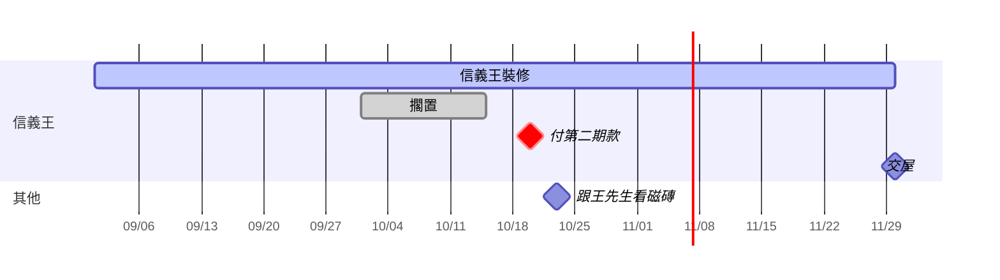

# 日程（第一題）
日期：2026-10-19
狀態：done（2026-10-20，v0.13.0）
版本：0.13.0

## 目的
到 v0.11.0，知識庫知道「信義王是一個案子、它的檔有哪些、現在怎樣」，但不知道「哪天要做什麼」：會議紀錄寫的下次開會、合約寫的交屋日、答應業主的報價期限，散在檔案卡的文字裡，沒有地方提醒。這題生 `agenda.json`：製卡時從檔案讀到的日期直接進日程，客戶在對話裡說的「9/25 下午有個會」「交屋改 12/10」「信義王結案了」由新的 note skill 記；開場印「日程：逾期 1、今天 0、7 天內 3」；`系統/日程.md` 列清單加一張甘特圖，案子的期間畫成 bar、日期畫成點。案子多了狀態（進行中、結案、擱置）：預設進行中，讀到驗收、尾款收清這類證據時 AI 問一句才改結案。對應使用者時刻：林小姐週一開對話，開場就知道這週要交兩份報價、有一筆款過期沒確認；她說「第二期款付了」，下次就不再提醒。

## 決策
D-125（日程拆兩題，這是第一題；含修訂：開始欄在第一題）、D-126（時段一律放日程、實體只放狀態）、D-127（事類狀態預設進行中、結束證據問一句、擱置只聽客戶）、D-128（製卡抽日期直接進日程標推測、回答末尾告知）、D-129（逾期依種類分）、D-130（原檔改版待重對日程）、D-131（note 第一版描述完整、本文只做日程與狀態）、D-132（SKILL 內容住哪裡：判斷在本文、細節在 references、介面在程式輸出）、D-134（結果清單與編號、strict）、D-135（一次最多 3 個問題與順序）。這題建在「整理 ingest」之上（`cards todo` 的 `plan`、`asks`、`tell` 與 `scripts/kb/_lib/plan.py`）。既有：D-006（日程是 note 的陳述、answer 的來源、hook 的窗口）、D-026（ingest 與 note 的判準、檔案與客戶說的衝突兩邊都講）、D-027（鍵名英文、客戶看到的中文）、D-039（事類有狀態機）、D-041（來源四選一）、D-060（開場日程行三個數字）、D-062（日程欄位與抽取規則）、D-067（渲染檔三行頭、格式住程式）、D-070（skill 描述 150 字、預算）、D-074（回合備份）、D-085（終端機記程式段）、D-089（manage 做不到就明說的做法）、D-091（路由測試 20 句）、D-105（日程.md 內含 Mermaid 甘特圖，bar 的定義已由 D-126 修訂）、D-107（第二題的欄位這題不做）、D-114～D-124（實體與綜合卡）、實體與綜合卡裁定 4／20（回答末尾一次最多 3 個問題，含 AI 自己加的）。事故：I-059（穩定訊號訓練客戶忽略）、I-083（一句「好」分不出答哪題）、I-086（數字綁日期）、I-088（日期只用正規表示式驗不夠，要真的解析）、I-089（英文自言自語，B-064）、I-097（解析器命中 0 筆要報錯）。

本題釐清、不改 D 的點：
- **日程條目掛實體用名稱**（同檔案卡，實體與綜合卡釐清第一點）：`kb entity rename`／`merge` 要把 `agenda.json` 裡的名稱一起換（備進回合）；`remove` 不動（已移除的實體名稱照留，知識不刪）。
- **一個實體可以有多條期間條目**（D-126 的設計期、施工期）：「信義王什麼時候開始」取它所有期間條目裡最早的開始；結案時連帶結束它所有還沒結束的期間條目。不設「整體期間」旗標。
- **狀態欄名用 `progress`**：`entities.json` 已有 `status`（active／removed／merged，實體本身在不在），事類的進行中、結案、擱置另一欄 `progress`（`ongoing|closed|paused`），歷程 `progress_history`。只有大類是「事」的實體有這兩欄。
- **綜合卡檔頭這題不顯示狀態**：綜合卡快取兩欄不動（D-118）；狀態看 `kb entity list`、`系統/日程.md`。綜合卡要不要多「狀態」「日程」兩欄等 answer 題。
- **擱置在甘特圖上**：擱置期間另畫一段灰色的「擱置」bar（Mermaid `done` 樣式）疊在同一個 section，不改原期間 bar；過了預計結束還沒結案的期間，另畫一段從預計結束到今天、標「逾預計結束」的 bar（`crit` 樣式）。D-126「畫淡」、D-129「虛線」照 Mermaid 做得到的樣式落地。
- **甘特圖不做點擊連結**：B-050 spike 還沒跑，bar 不帶 `click`；Obsidian 裡 Mermaid 甘特圖照常顯示即可。
- **「N 天內」用 `agenda_window_days`（7）**：條目自己有 `lead_days` 就用它；開場與日程.md 的「接下來」都用同一個判斷。
- **逾期、今天、接下來的計算只看 `open`**；會議與提醒過了日期就算「已過去」（D-129），日程.md 的過去區列最近 `agenda_past_days`（30）天的已過去、完成、取消。
- **note 收到的話來源標「確認」**：客戶在對話裡親口說的新日程與改期標 `confirmed`；改推測的條目標 `corrected`（D-041）。
- **三種新問題都由程式給結果清單（D-132、D-134）**：
  - **逾期**：程式自己認得（`TRACKED`、open、日期已過），`asks` 直接列。
  - **結案**：結束證據只有製卡者讀了才認得，所以製卡者不自己問，叫 `kb entity suggest-close <名> --evidence f-…` 記一條待處理（kind `close`）；同一份證據已在 `asked_evidence` 或已有 open 的同一條就不重記、印一句。程式從待處理把它列進 `asks`。客戶答了跑的 `kb entity progress` 會自動關掉這條待處理。
  - **日程有出入**（D-130 確認或糾正過的條目，新版寫法不同）：製卡者不自己問，叫 `kb agenda recheck <a-…> --propose-date <日期> [--propose-text "<一句>"]` 記在條目的 `proposal`；程式把有 `proposal` 的列進 `asks`。來源推測的照舊直接 `edit`。
- **問題的順序**（D-135 插入日程題的三種）：實體夾或綜合卡不見了 → 實體夾其他變化 → 原檔不見 → 逾期 → 日程有出入 → 結案 → 名字確認。逾期排在原檔不見後面，因為付款期限過了要追；結案不急。
- **`kb asks`**：只回 `asks` 與 `tell`（同 `plan.build`、不含 `plan`），給沒有跑 ingest 的時候用：開場有逾期、note 回答末尾。ingest 照舊用 `cards todo --json`，兩者同一支函式、編號一樣從 1 起。
- **`tell` 多兩種**：這一回合加進日程的條目（「加進日程：10/5 開會、10/20 付第二期款、11/30 交屋」，超過 5 條講條數；D-128）、這一回合照新版改了的推測條目（「交屋從 11/30 改成 12/15 了」；D-130）。用條目的 `created_turn` 與 `history` 的回合比對目前回合。
- **`fill` 一律物件、每個都帶 rule**：`{"name": "新名字", "rule": "…"}`、`{"name": "客戶的話", "rule": "…"}`，不再字串與物件混用（整理 ingest 裁定 12 留下的）；整理 ingest 已有的空格一起改，測試照改形狀。名字類（新名字、同一個）的 rule 也擋 `"`、`$`、反引號、`\` 四種字元（整理 ingest 測試第二輪：`--to 'Ben$Co'` 程式收、但貼進雙引號會被 shell 展開成 `Ben`）；`entities.name_problem` 同時擋這四種字元，名字從源頭就不會有。
- **英文自言自語（B-064）這題處理一部分**：`skeleton/CLAUDE.md` 加一句（見要做的事第 9 點），note 本文不用「第 N 步」編號；已建好的知識庫要等升級題才拿得到新 CLAUDE.md，確認環境手動補那一句。

### 實作疑義裁定（2026-10-20，實作 c6fbb40 回報的 12 點）
1. **成功句帶星期**：`agenda add` 與 `edit` 改到日期的成功句，日期後接「（週X）」（見要做的事第 2 點）。AI 自己推星期常算錯，程式給好，AI 複述時照念、客戶對得出錯。測試照改。
2. **追認十一點**：`agenda edit --card f-…` 給推測條目照新版重對，來源維持推測、更新 `origin.fp`（驗收 10c 要的）（2）；多的拒絕句：`這份還沒有檔案卡，先寫卡再加日程`、`日程要有一句說明`、`提前天數要是 0 以上的整數`、`沒有給要改的欄位`、`這條不是從這張卡抽的`、`這條不是從檔案卡抽的，沒有可以對的版本`（3）；實體用別名或合併前的名稱時存登記的名稱，找不到才拒（4）；`suggest-close` 對不是進行中的實體不記、exit 0、印「「X」目前是擱置，不用問結案」，依據要在清冊，close 待處理去重連實體一起比（5）；擱置段只畫在有期間 bar 的 section、零長度畫 `1d`、done 的期間畫到 `ended`（6）；`tell` 與 `agenda_conflict` 問句有出處卡標題就帶標題，「加進日程」只算有出處且 open 的，超過 5 條講「加進日程 N 條，看 系統/日程.md」（7）；名字類 rule 加「有空白就加雙引號」（8）；`agenda.json` 讀不到時 `cards.todo` 不擋、日程那部分給空並記 log、不問日程題（9）；新測試放 `test_lib_entities_progress.py`、close 的待處理測試在 `test_lib_pending.py`（10）；`commands.md` 144 行，B-067 已記（11）。
3. **沒做的接受**：hook-development 沒另讀（照既有 `line_*` 寫法）；ingest 只動本文一句與 reference，不做 skill-creator 新舊版對照。

### 確認後裁定（2026-10-20，對 `design/reports/日程-確認.md` 與 `design/reports/日程-測試.md` 的「其他發現」；確認第 7 步不過，判定 spec 缺口）
4. **檔案卡抽日期由程式列（D-140）**：確認第 2 步是「已經有卡、沒有新檔」時客戶說「把日期也整理進日程」，spec 只寫了「寫完卡接著讀第九節」，沒寫卡就沒有路，AI 改走口述，條目成了 `confirmed`、沒有出處，第 7 步的 `agenda_recheck`、`agenda_conflict`、`tell` 全沒機會跑。改成：
   - 清冊條目多選填欄 `agenda_fp`：製卡者對一張卡抽完日期（含沒抽到任何日期）時那張卡的 `指紋`；掃描保留（同 `skip_kind`）。
   - 新子子命令 `kb agenda scanned <f-…>`：記這張卡現在的指紋；成功 `已記下：「<卡標題>」的日期抽過了`；拒絕（exit 3）`清冊沒有 f-…`、`這份還沒有檔案卡，先寫卡再抽日期`。終端機記程式段、對話裡併進回合；寫前備進回合。
   - `cards.todo` 多一桶 `agenda_unscanned`：active 的檔案卡、`agenda_fp` 不等於卡現在的指紋（含沒有）。每項帶卡的路徑、標題，以及 `existing`：出處是這張卡、還是 open 的條目（編號、種類、日期、文字），讓製卡者知道哪些已經在、只加沒有的。人讀第一行多「；日程待抽 N」。
   - `plan` 的順序：`cards` → `agenda_recheck` → `agenda_unscanned`（`read` 都是 carding.md 第九節）→ 其餘照舊。先重對再抽，重做的卡不會多出重複的條目。份數算進 `ingest_auto_max` 的門檻（`new`＋`stale`＋`unlinked`＋`agenda_unscanned`；門檻值這題不改，D-100 修訂在 note 改規則題做）。
   - carding.md 第九節：開頭改成「`plan` 有 `agenda_unscanned` 這一步時照這節做；一張卡抽完跑 `kb agenda scanned`，沒抽到也要跑」；刪掉第六節那句「寫完卡接著讀第九節」（補丁，由 `plan` 承接）。note 本文的分辨加一句：「要把檔案裡的日期整理進來」是整理，照 `cards todo --json` 的 `plan` 做（ingest），不是口述。
5. **note 收尾的告知只帶這一回合做了什麼（D-141）**：`kb asks` 的 `tell` 只有「加進日程」「照新版改了」兩種（這一回合的動作句）；讀不到、不製卡、依設定不整理、缺型別、雲端這些整理狀態只在 `cards todo` 的 `tell`。`plan.build` 加參數區分，同一支函式。
6. **內部編號不出現在給人看的輸出**：`kb agenda add|edit|done|cancel|reopen|recheck|list|scanned` 的人讀輸出不印 `a-…`、`f-…`；`add` 推測的「（推測，出處 f-…）」改「（推測，出處：<卡標題>）」；`list` 一行 `- 2026-11-30（週一）到期 交屋（信義王）〔推測〕`。`--json` 照舊帶編號，AI 要編號從 `--json` 取（note 骨架本來就是 `list --json`）。`references/agenda.md` 成功句的表照改。確認第 7 步 AI 把 `a-a7ce9bb9` 唸給客戶。
7. **測試報告「其他發現」要修的**：
   - (a) `entity remove`、`merge` 時，那個實體 open 的 `close` 待處理一起 `dismiss`（同一把鎖、同一套 `_Undo`）；不然永遠留在 `待處理.md`、`asks` 不問、客戶清不掉。
   - (b) 期間條目 `agenda done` 時 `ended` 是空的就填今天；甘特圖與過去區照 `ended` 畫（`close_periods` 已是這樣）。
   - (c) ingest `references/commands.md`：補 `todo --json` 的 `agenda_recheck`、`agenda_unscanned` 每項的形狀、`agenda_counts`、`entities` 多的 `progress`／`asked_evidence`、人讀第一行的「；日程待重對 N；日程待抽 N」，entity 表補 `suggest-close` 一列。仍 ≤ 150 行；放不下就把日程相關欄位寫進 note 的 `references/agenda.md`，commands.md 留一行指過去。
   - (d) README 例句不寫「今天 0」（0 的項不印）。
   - 其餘低項記 B-073，不在這輪修。
8. **不改的**：note 描述「開場有『日程：逾期』時都用這個」跟「問現況不用」的拉扯（測試 skill-reviewer major ①），路由測試環境沒有開場行測不出來；確認重跑第 3 步有逾期時看有沒有誤觸發，誤觸發才改描述（改描述要重跑路由，D-131）。
9. **這輪的驗收**（加在驗收準則後面，測試只驗這些加無退步）：
   - 19. `agenda scanned` 成功與兩種拒絕；`cards todo --json` 的 `agenda_unscanned`：新卡、舊卡（沒有 `agenda_fp`）、卡重做後指紋變了都列，標過不列；`existing` 對；`plan` 三步的順序；份數算進門檻（`--limit` 預設照 `ingest_auto_max`）。
   - 20. `kb asks --json` 的 `tell` 在有讀不到、不製卡的知識庫裡不帶那些句子，`cards todo --json` 的 `tell` 照帶。
   - 21. `agenda` 各子子命令的人讀輸出沒有 `a-`、`f-` 開頭的編號（一個正規表示式掃全部輸出）；`--json` 有。
   - 22. 7(a)～(d) 各一個實跑證據。
   - 23. `test_skill_note`、`test_skill_ingest` 照過；carding.md 沒有「寫完卡接著讀第九節」。全部測試 exit 0。
10. **確認重跑**（只重跑第 2、3、4、7、8、9 步；1、5、6 已過）。開始前由**使用者自己**做（確認 session 不照跨 session 訊息改設定，這次它沒做）：停用舊 llm-wiki；在 `知識庫\CLAUDE.md` 補第 9 點那句；刪掉 `.system\agenda.json` 與 `系統\日程.md`（上一輪的三條是口述、會跟推測的重複）；在終端機加一條過期的條目 `kb agenda add --kind 到期 --date 2026-10-15 --text 付第二期款`（給第 3 步的逾期題）。第 2 步看 AI 照 `plan` 用 `--card` 加、條目〔推測〕、回答末尾「加進日程：…」、沒先問就加（D-128）。第 4 步改期改的是一條推測的條目 → 變 `corrected`。第 7 步改一份第 2 步已抽出推測條目的原檔的日期（上一輪改過的進度.xlsx 在第 8 步只退了卡，原檔仍是新版；第 2 步整理時會先重做那張卡），看 `agenda_recheck` 照新版 `edit` 與「X 從 A 改成 B 了」。第 8 步退回第 7 步，`agenda.json` 要回去。第 9 步另看回答裡沒有編號、note 回合的末尾沒有讀不到那類句子。
11. **確認後修正的實作回報裁定**（實作 d869778、0b72992、a73bc06；設計在 worktree 重跑 1460 測試 exit 0）：追認 (1) 既有測試期望值照裁定 5、6 改；`test_scripts_cards_cli` 的三個測試在 setup 先標抽過，因為只要有卡還沒抽日期就不印「卡都是最新的」，這是對的（有事要做）；(2) `agenda_unscanned` 每項 `{id, card_path, title, existing:[{id, kind, date, text}]}`；(3) 檔頭壞的卡不列，重寫後才列；(4) `agenda_fp` 存指紋前 12 碼（同 `origin.fp`，內容指紋優先）；(5) 新卡剛寫完要下一次 `cards todo` 才列（骨架本來就每步重跑）；(6) 拒絕句照 spec 回顯客戶給的編號，AI 照共通節轉成白話；(7) 推測條目沒有卡標題只標「（推測）」。**補一句**（skill-reviewer major (a)）：carding.md 第九節開頭加「抽到的日期直接加，不逐條先問客戶；加了哪些由回答末尾的 `tell` 告知，錯了客戶說一聲就改（D-128）」——上一輪確認第 2 步 AI 先問才加。ingest 本文的分辨不加（走到 ingest 就照 `plan` 做，note 已有交棒句）。其餘 reviewer 低項記 B-073。補完 commit 後跑全部測試。

## 要做的事

1. **`scripts/kb/_lib/agenda.py`（新）**：`.system/agenda.json` schema 1 與渲染 `系統/日程.md`。
   - 常數：`AGENDA_POSIX = ".system/agenda.json"`、`MD_POSIX = "系統/日程.md"`、`SCHEMA_VERSION = 1`；`KINDS = {"到期": "deadline", "會議": "meeting", "承諾": "promise", "提醒": "reminder", "期間": "period"}`；`TRACKED = ("deadline", "promise")`（過了才算逾期，D-129）；`PASSING = ("meeting", "reminder")`（過了就算已過去）；`STATUSES = ("open", "done", "cancelled")`。
   - `load(vault)`：沒檔回空的 schema 1；形狀不對（不是物件、`items` 不是清單、元素不是物件、版本比這版新）丟 `ValueError`，訊息帶 `.system/agenda.json`。
   - `parse_date(text)`：只收 `YYYY-MM-DD`，用 `datetime.strptime` 真的解析（2026-13-99、2026-02-30 都錯，I-088）；`parse_time` 只收 `HH:MM`（00:00～23:59）。
   - `add(vault, kind, date, text, entities, turn_id, start=None, time=None, card=None, source=None, lead_days=None)`：驗（種類、日期、開始不晚於日期、`period` 一定要有開始且掛一個實體、實體名稱要是 `entities.json` 裡 status 不是 merged 的名稱、`card` 要在清冊且是 active 的檔案卡）；`card` 有給 → `source: "inferred"`、`origin: {"card": <編號>, "fp": <那張卡現在的 fp>}`；沒給 → `source` 照參數（預設 `confirmed`）；同一張卡已有同種類、同日期、同文字的 open 條目 → 不重複、回既有。寫前 `turn.backup`；寫完重渲染 md。
   - `edit(vault, id, turn_id, **fields)`：改 `date`、`start`、`time`、`text`、`entities`、`lead_days`；來源是 `inferred` 而這次不是帶 `card` 的重對 → 改 `corrected`；`history` 加一筆 `{"date": 今天, "change": "date 2026-11-30 → 2026-12-15", "by": "ai"|"program"}`。
   - `set_status(vault, id, status, turn_id)`：done、cancelled、open（重開）；`history` 記一筆。
   - `recheck(vault, id, turn_id, propose_date=None, propose_text=None)`：沒帶提議 → 只把 `origin.fp` 更新成那張卡現在的 fp（製卡者看過新版、這條不用改）；帶提議 → 只收來源 `confirmed` 或 `corrected` 的條目（推測的回 `推測的條目直接 edit，不用提議`），把 `{"date", "text", "card", "fp"}` 記在 `proposal`、`origin.fp` 也更新。`edit` 或再一次不帶提議的 `recheck` 清掉 `proposal`。
   - `cancel_from_card(vault, card_id, turn_id)`：`cards drop` 拿掉檔案卡時呼叫：出處是它、來源 `inferred`、還是 open 的條目改 cancelled，回動到的條目。
   - `rename_entity(vault, mapping, turn_id)`：`entities.rename`／`merge` 呼叫，把 `entities` 清單裡的舊名換新名、去重。
   - `close_periods(vault, entity_name, date, turn_id)`：該實體 open 的 `period` 條目填 `ended: <date>`、status done。
   - `buckets(vault, data)`：給 `cards.todo`：`agenda_recheck`（出處卡現在的 fp 不等於 `origin.fp`、條目 open 的；每項帶條目、卡的路徑、`source`）。
   - `counts(vault, data, today)`：`{"overdue", "today", "upcoming"}`：overdue 是 `TRACKED`、open、日期 < 今天；today 是 open、日期 = 今天（期間不算）；upcoming 是 open、今天 < 日期 ≤ 今天 + (`lead_days` 或 `agenda_window_days`)（期間不算）。
   - `render(vault, turn_id=None)`：寫 `系統/日程.md`（格式見「資料與介面格式」）；有 `turn_id` 先備進回合；內容沒變不寫。
   - 鎖：讀改寫都在 `FileLock(agenda.json)` 裡。

2. **`scripts/kb/agenda_cli.py`（新）子命令 `kb agenda add|edit|done|cancel|reopen|recheck|list|render`**，都收 `--vault`、`--json`。寫入的子命令終端機跑記程式段（D-085），對話裡叫的併進回合。
   - `add --kind <到期|會議|承諾|提醒|期間> --date YYYY-MM-DD --text "<一句>" [--start YYYY-MM-DD] [--time HH:MM] [--entity <名稱>]… [--card f-…] [--lead-days N]`：成功 `已加進日程：2026-11-30（週一）交屋（到期，信義王）a-1b2c3d4e`；推測的多「（推測，出處 f-…）」。
   - `edit <a-…> [--date] [--start] [--time] [--text] [--entity …] [--lead-days]`：`已改：交屋 2026-11-30（週一）→ 2026-12-15（週二）`（只改日期以外的欄位時不帶星期）。
   - `done`／`cancel`／`reopen <a-…>`：`已記成完成：第二期款`、`已取消：10/5 開會`、`已重開：…`。
   - `recheck <a-…> [--propose-date YYYY-MM-DD] [--propose-text "<一句>"]`：沒帶 `已對過新版，不用改：…`；帶了 `已記下新版的寫法，會問客戶要用哪個：交屋 12/15（客戶說的）↔ 12/20（新版）`。
   - **`kb asks [--json]`（新，`scripts/kb/asks_cli.py`）**：只讀，回 `{"asks", "tell"}`（`plan.build` 同一支，跑一次 `cards.todo` 再取這兩鍵）；人讀照編號印問題與選項，沒有就印 `沒有要問的`。
   - `list [--all]`：預設列 open 的，照日期排，一行一條 `- a-… 2026-11-30 到期 交屋（信義王）〔推測〕`；`--all` 含過去與完成；沒有印 `日程是空的`。
   - `render`：手動重寫 `系統/日程.md`，印 `日程：N 條`。
   - 拒絕（exit 3）：`日期要寫 YYYY-MM-DD，而且是真的日期`、`時間要寫 HH:MM`、`開始不能晚於日期`、`期間要有 --start，而且只掛一個實體`、`實體清單沒有「X」，先 kb entity add`、`種類要是 到期、會議、承諾、提醒、期間 之一`、`清冊沒有 f-…` 或 `這張卡的原檔已不在`、`日程沒有 a-…`、`狀態檔讀不到：.system/agenda.json（…）`、`等不到鎖，沒有寫入`。

3. **`scripts/kb/_lib/entities.py`** 升 schema 2。
   - `load` 讀到 schema 1 在記憶體遷移：大類是「事」的條目（型別在設定檔第一節、大類 matter）補 `progress: "ongoing"`、`progress_source: "inferred"`、`progress_history: []`；寫的時候寫 schema 2。`add` 新增事類實體時同樣補。
   - `set_progress(vault, ref, progress, turn_id, evidence=None, note=None, source="confirmed")`：只收事類實體（不是 → `「X」不是「事」類，沒有狀態`）；`progress_history` 加一筆 `{"date", "progress", "source", "evidence": [f-…], "note"}`；`progress` 改 `closed` 時同一把鎖裡叫 `agenda.close_periods(名稱, 今天)`；從 `closed` 改回 `ongoing` 不重開期間（印一句「期間條目沒有重開，要的話說改期」）。同 `progress` 再設一次只加歷程（「客戶說還沒結案」用這個，D-127）。
   - `asked_evidence(entry)`：歷程裡全部 `evidence` 的聯集，加上 open 與已處理的 `close` 待處理裡的依據（問過的證據不再問）。
   - `suggest_close(vault, ref, evidence, turn_id)`：只收事類、`progress` 是 ongoing 的實體；證據都已在 `asked_evidence` → 不記、回 `skipped`；否則 `pending.add(kind="close", entity_ids=[編號], file_ids=evidence, text="「X」看起來已經結束了，要記成結案嗎？", reason="依據〔f-…〕")`。`set_progress` 寫完把這個實體 open 的 `close` 待處理 `auto_done`。
   - `scripts/kb/_lib/pending.py`：kind 多 `close`（只准這一處：`add` 收 `entity_ids`、`系統/待處理.md` 多一段「要確認結案的」）。
   - `rename`／`merge` 多叫 `agenda.rename_entity`（同一套 `_Undo` 還原）。

4. **`scripts/kb/entity.py`**：多子子命令 `progress <名稱> <進行中|結案|擱置> [--evidence f-…]… [--note "<一句>"]`：`已記成結案：信義王（期間 1 條一起結束）`、`已記下：信義王還在進行中（客戶說還沒結案）`、`已記成擱置：大安陳`；終端機記程式段。`suggest-close <名稱> --evidence f-…`：記了印 `已記下，會問客戶「信義王」要不要記成結案`；證據問過印 `這份依據問過了，不再問`（exit 0）。`list` 每行事類多「進行中／結案／擱置」。

5. **`scripts/kb/_lib/cards.py` 與 `scripts/kb/cards.py`**：`todo` 多一桶 `agenda_recheck`（`agenda.buckets`）與一塊 `agenda_counts`；`entities` 塊的事類條目多 `progress` 與 `asked_evidence`。人讀第一行多「；日程待重對 N」。`drop` 拿掉卡後叫 `agenda.cancel_from_card`，印多一行 `從這張卡抽的日程 N 條改成取消`。
   **`scripts/kb/_lib/plan.py`**：
   - `plan` 在 `cards` 之後多一步 `agenda_recheck`（`read` 是 `references/carding.md 第九節`）；抽日期不另成一步（寫卡時就做，carding.md 第九節）。
   - `asks` 多三種 kind，照釐清的順序插入：
     - `overdue`：問「10/20 付第二期款（信義王）過了，完成了嗎？」；結果「完成了」→ `kb agenda done <a-…>`；「不用了」→ `kb agenda cancel <a-…>`（strict）；「還沒，改到某天」→ `kb agenda edit <a-…> --date {新日期}`（`fill` 帶 rule「YYYY-MM-DD」）；「還沒，下次再問」→ `do` 空、`note`「這個對話不再問」。
     - `agenda_conflict`：問「交屋你之前說 12/15，新版合約寫 12/20，要用哪個？」；結果「用新版 12/20」→ `kb agenda edit <a-…> --date 2026-12-20`（帶 `--text` 若提議有改文字）；「維持 12/15」→ `kb agenda recheck <a-…>`。
     - `close`：問待處理的 `text` 加依據；結果「對，結案了」→ `kb entity progress <名> 結案 --evidence <f-…>`；「還沒」→ `kb entity progress <名> 進行中 --evidence <f-…> --note "客戶說還沒結案"`；「先暫停了」→ `kb entity progress <名> 擱置 --evidence <f-…>`。
   - `tell` 多「加進日程」「照新版改了」兩種（釐清）。
   - `fill` 一律物件（釐清）。

6. **`hooks/session.py`**：`line_agenda` 實作：`agenda.counts` 三個數字，0 的項不印、全 0 整行不印：`日程：逾期 1、今天 0、7 天內 3` 的形狀，有逾期時後面接 `（回答末尾跑 kb asks 照著問）`；`7` 照 `agenda_window_days`。各自 try（I-046）。`test_budget` 的最壞情況加日程行（七行）仍 ≤ 8 行 400 字，八個數字不改。

7. **`skills/note/`（新）**：先讀 `plugin-dev:skill-development`；描述用 `skill-creator:skill-creator` 寫，≤ 150 字（D-070），涵蓋 note 的全部（D-131）：偏好、日程與承諾、糾正、決定與裁示、「把這個記下來」、加型別與改型別名。
   - 寫法照 D-132 與 `skill-creator:skill-creator` 的 Writing Style（解釋為什麼、不堆「一定要」）。
   - `SKILL.md` 本文（目標 ≤ 3000 字、上限 120 行 5000 字）：**分辨**（日程的話、狀態的話、這版做不到的其他類、回答上一則問題的話）；**原則**各帶一句理由加編號（改既有的先找、找不到或有兩條像的才問是哪一條；日期換算完在回答裡複述讓客戶看得到；這版做不到的不寫任何檔、不說「記下了」（D-131）；結案只聽客戶的（D-127）；一次最多 3 個問題（D-135））；**骨架**：日程的話 → 照 `references/agenda.md` 判種類與日期、新的 `add`、改的先 `list --json` 再 `edit`／`done`／`cancel`；狀態的話 → `kb entity progress`；回答末尾跑 `kb asks --json` 照 `asks` 問（客戶回上一則的問題時照那一則列的結果做，不先重跑）；`turn note` 一句。本文沒有任何欄位名與指令參數對照（`test_skill_note` 守）。
   - `references/agenda.md`（≤ 150 行）：種類怎麼從話判（「有個會」會議、「答應…前給」承諾、「…前要繳／交」到期、「提醒我」提醒）；日期的說法（民國、沒說年份取今天之後最近的那天、「下週三」「月底」怎麼換）；`kb agenda`、`kb entity progress`、`kb asks` 的參數、成功句、拒絕句怎麼跟客戶說。
   - `tests/evals/note.json`：20 句，該觸發 10 句涵蓋完整範圍（不只日程與狀態）、不該觸發 10 句（ingest 的「我改了報價單」、manage 的「把 D 槽加進來」、answer 的「這週要做什麼」「信義王現在怎樣」等）。
   - `tests/test_skill_note.py`：守形狀（同 `test_skill_ingest`）。

8. **`skills/ingest/`**：
   - `references/carding.md` 新一節「九、日程與狀態」：照 D-062 抽日期（未來的日期加一個動作才進，過去的進綜合卡紀事；會議紀錄的開會日是過去、裡面提到的下次開會與期限是未來）；用 `kb agenda add --card <這張卡的編號>` 加，種類照文意；合約或進度表寫的工期（開始到結束）加成 `期間` 掛那個案子；加進日程的那幾條由 `tell` 帶出來，不用自己列（D-128）；`agenda_recheck`（D-130）：推測的照新版 `edit` 或 `cancel`、沒變就 `recheck`、確認或糾正過的而新版不同就 `recheck --propose-date`（程式會問客戶，自己不問）；讀到結束證據（驗收紀錄、尾款收清、寫明結案；「驗收第一期」這類中間事件不算）→ `kb entity suggest-close X --evidence f-…`（程式會問、問過的證據不再問），不直接改狀態（D-127）。
   - `SKILL.md` 本文：骨架是通用的（照 `plan`、照 `asks`），不用為日程加步驟；只改「`changes` 查無變動」那條：「說『檔案看起來跟上次一樣，是不是還沒存檔？』；說的是口頭的事（付款條件談好了、會改期）就照 note skill 做」。`test_skill_ingest` 的反向檢查照守（本文不出現 `agenda`、`suggest-close` 這類指令）。
   - `references/commands.md`：仍 ≤ 150 行；`agenda`、`asks` 指令不寫在這裡，寫一行指到 note 的 `references/agenda.md`。

9. **`skeleton/CLAUDE.md`**：第一段「回答客戶一律繁體中文」後面加「工具之間的過場也是給客戶看的，一律繁體中文、不唸步驟編號」（B-064）；`test_budget` 的 25 行 1200 字照守。

10. **`config/defaults.json`**：加 `agenda_window_days: 7`（開場與日程.md 的「接下來」天數，D-060）、`agenda_past_days: 30`（日程.md 過去區列幾天內的），各帶 `_why_`。

11. **`scripts/kb/cli.py`** 加 `agenda`；**`scripts/kb/init.py`** 不建 `agenda.json`（第一次寫時才建），但缺 `系統/日程.md` 時渲染一份空的。

12. **`README.md`**：「怎麼用」加「日程」一段：說「9/25 下午有個會」「答應王先生 10/10 前給報價」「交屋改 12/10」「第二期款付了」「信義王結案了」；製卡時讀到的日期會自動加進來並標推測；開場的「日程：逾期 1、今天 0、7 天內 3」；`系統/日程.md` 的清單與甘特圖。終端機指令清單加 `kb agenda …`、`kb entity progress`。repo `CLAUDE.md` 地圖加 `agenda.py`、`agenda_cli.py`、`skills/note/`，`entities.py`、`entity.py`、`cards.py`、`session.py`、`skeleton/CLAUDE.md`、`config` 那幾列照改。

13. **測試**：`tests/test_lib_agenda.py`（日期解析的錯各一含 2026-02-30；add 的驗證與冪等；edit 的來源與歷程；counts 的三種與 D-129 的種類分法、期間不算、`lead_days`；render 等於 fixture；buckets；cancel_from_card；rename_entity）；`tests/test_scripts_agenda_cli.py`（黑箱：每個子子命令成功與拒絕各一、終端機程式段、對話裡不記、revert 後 `agenda.json` 與 md 回去）；`tests/test_lib_entities.py` 加 schema 1→2 遷移、`set_progress` 結案連帶結束期間、非事類拒絕、`asked_evidence`、rename 連日程；`tests/test_scripts_entity_cli.py` 加 `progress`；`tests/test_lib_cards.py` 加 `agenda_recheck`、drop 連帶取消；`tests/test_hooks_session.py` 加日程行三種（沒有、有逾期帶提示、全 0 不印）與 `agenda.json` 壞了其他行照印；`tests/test_budget.py` 最壞情況加日程行；`tests/test_skill_note.py`（形狀；本文沒有欄位名、沒有 `agenda edit` 這類指令對照；原則含 D-127、D-131、D-135）；`tests/test_lib_plan.py` 加 `overdue`、`agenda_conflict`、`close` 三種的結果清單與 `do` 字串、順序插在對的位置、`fill` 一律物件、`tell` 兩種新句子；`tests/test_lib_entities.py` 加 `suggest_close` 的記與不重記、`set_progress` 關掉 close 待處理；`tests/test_lib_agenda.py` 加 `recheck` 提議的收與拒；`tests/test_scripts_asks_cli.py`（`kb asks` 跟 `cards todo --json` 的 `asks`、`tell` 一樣）。fixture：`tests/fixtures/agenda/`（一份 `agenda.json` 涵蓋五種種類、三種狀態、推測與確認、一條過期的到期、一條過期的會議、一條期間與它的擱置歷程；它渲染出的 `日程.md` 期望輸出）。

## 來源程式對照
舊程式在 `C:\Users\Jie\Desktop\third party\`。

| 舊檔 | 怎麼用 |
|---|---|
| llm-wiki `scripts/agenda.py`（日期用正規表示式加 strptime 雙重驗、逾期與 N 天內的計算） | 改介面：驗證照搬精神（I-088），資料改住 `agenda.json` 帶實體與出處 |
| llm-wiki `templates/vault/wiki/meta/agenda-system.md`、`skills/wiki-agenda/SKILL.md` | 照搬精神：日期集中一處、外部日曆不讀（I-088）；口述的說法參考 |
| plugin `skills/query/SKILL.md` 的日程查詢 | 不要（answer 題） |
| 其餘 | 全新 |

## 資料與介面格式

### `.system/agenda.json`（schema 1）
```json
{"schema_version": 1,
 "items": [
  {"id": "a-1b2c3d4e", "kind": "period", "start": "2026-09-01", "date": "2026-11-30", "ended": null, "time": null,
   "text": "信義王裝修", "entities": ["信義王"], "status": "open", "source": "inferred",
   "origin": {"card": "f-07df81a8", "fp": "9f2c1e0a7b3d"}, "lead_days": null,
   "created_turn": "20261020-…", "history": []},
  {"id": "a-5e6f7a8b", "kind": "deadline", "start": null, "date": "2026-10-20", "ended": null, "time": null,
   "text": "付第二期款", "entities": ["信義王"], "status": "open", "source": "inferred",
   "origin": {"card": "f-bb005110", "fp": "1a2b3c4d5e6f"}, "lead_days": null, "created_turn": "…",
   "history": [{"date": "2026-10-21", "change": "date 2026-10-15 → 2026-10-20", "by": "ai"}]},
  {"id": "a-9c0d1e2f", "kind": "meeting", "start": null, "date": "2026-09-25", "ended": null, "time": "14:00",
   "text": "跟王先生看磁磚", "entities": [], "status": "open", "source": "confirmed", "origin": null,
   "lead_days": null, "created_turn": "…", "history": []}]}
```
`id` 是 `a-` 加 8 碼 hex；`kind` 值 `deadline|meeting|promise|reminder|period`；`status` 值 `open|done|cancelled`；`source` 同 D-041；`ended` 只有期間用；`origin` 只有製卡抽出的有，`fp` 是那張檔案卡的 fp 前 12 碼（同 D-121「整理到」）。

### `entities.json` schema 2（事類條目多的欄）
```json
{"progress": "ongoing", "progress_source": "inferred",
 "progress_history": [{"date": "2026-11-01", "progress": "paused", "source": "confirmed", "evidence": [], "note": "業主出國"},
                      {"date": "2026-12-01", "progress": "ongoing", "source": "confirmed", "evidence": ["f-3a553095"], "note": "客戶說還沒結案"}]}
```
`progress` 值 `ongoing|closed|paused`，客戶看到的是進行中、結案、擱置。

### `系統/日程.md`
~~~markdown
# 日程
這是什麼：要做的事與日期，程式從 .system/agenda.json 整理出來；〔推測〕是我從檔案讀到的，不對就跟我說。
怎麼用：跟我說「9/25 下午有個會」「交屋改 12/10」「第二期款付了」就會改這裡。
由程式產生，改了會被覆蓋。

## 逾期
- 2026-10-20（週二）到期 付第二期款（信義王）〔推測〕

## 今天
（沒有）

## 接下來 7 天
- 2026-10-23（週五）14:00 會議 跟王先生看磁磚

## 之後
- 2026-11-30（週一）到期 交屋（信義王）〔推測〕

## 時程圖


## 過去 30 天
- 2026-10-05 會議 再開一次會（信義王）已過去
- 2026-10-01 承諾 給王先生報價（信義王）完成
~~~
「今天」「接下來」沒有條目時那節寫「（沒有）」；`items` 全空時整份只有三行頭與「日程是空的；說「9/25 下午有個會」我就記下來。」。甘特圖：一個實體一個 section（照實體名稱排），不掛實體的在最後的 `其他`；期間是 bar（open 的 `active`、done 的 `done`、過了預計結束還 open 的另加一段「逾預計結束」`crit` 到今天）；其他種類是 `milestone`（逾期的加 `crit`）；擱置照 `progress_history` 每段畫一條「擱置」`done`；只畫 open 與過去 `agenda_past_days` 天內的；條目文字裡的 `:`、`#`、`;` 換成全形，換行壓成空白。甘特圖沒有任何條目時整節不印。

### 開場日程行
```
日程：逾期 1（回答末尾跑 kb asks 照著問）、7 天內 3
日程：7 天內 2
```

### `kb cards todo --json`（新欄位）
```json
{"agenda_recheck": [{"id": "a-…", "card": "f-…", "card_path": "檔案索引/…", "kind": "到期", "date": "2026-11-30",
   "text": "交屋", "source": "inferred"}],
 "agenda_counts": {"overdue": 1, "today": 0, "upcoming": 3},
 "entities": [{"name": "信義王", "type": "案子", "aliases": [], "self": false,
   "progress": "ongoing", "asked_evidence": ["f-3a553095"]}]}
```

### `asks` 的三種新題（`cards todo --json` 與 `kb asks --json` 同形）
```json
[{"id": "overdue:a-5e6f7a8b", "kind": "overdue",
  "question": "10/20 付第二期款（王宅）過了，完成了嗎？",
  "results": [
    {"n": 1, "label": "完成了", "do": ["kb agenda done a-5e6f7a8b"], "strict": false, "fill": []},
    {"n": 2, "label": "不用了", "do": ["kb agenda cancel a-5e6f7a8b"], "strict": true, "fill": []},
    {"n": 3, "label": "還沒，改到某天", "do": ["kb agenda edit a-5e6f7a8b --date {新日期}"], "strict": false,
     "fill": [{"name": "新日期", "rule": "YYYY-MM-DD"}]},
    {"n": 4, "label": "還沒，下次再問", "do": [], "strict": false, "fill": [], "note": "這個對話不再問"}]},
 {"id": "conflict:a-1b2c3d4e", "kind": "agenda_conflict",
  "question": "交屋你之前說 12/15，新版合約寫 12/20，要用哪個？",
  "results": [
    {"n": 5, "label": "用新版 12/20", "do": ["kb agenda edit a-1b2c3d4e --date 2026-12-20"], "strict": false, "fill": []},
    {"n": 6, "label": "維持 12/15", "do": ["kb agenda recheck a-1b2c3d4e"], "strict": false, "fill": []}]},
 {"id": "close:p-9a8b7c6d", "kind": "close",
  "question": "「王宅」看起來已經結束了，要記成結案嗎？（依據：信義王驗收紀錄）",
  "results": [
    {"n": 7, "label": "對，結案了", "do": ["kb entity progress 王宅 結案 --evidence f-3a553095"], "strict": false, "fill": []},
    {"n": 8, "label": "還沒", "do": ["kb entity progress 王宅 進行中 --evidence f-3a553095 --note 客戶說還沒結案"], "strict": false, "fill": []},
    {"n": 9, "label": "先暫停了", "do": ["kb entity progress 王宅 擱置 --evidence f-3a553095"], "strict": false, "fill": []}]}]
```
`tell` 多：`加進日程：10/5 開會、10/20 付第二期款、11/30 交屋`、`交屋從 11/30 改成 12/15 了（新版合約）`。

### 工作日誌程式段
`agenda add`：`加進日程：2026-11-30 交屋`；`edit`：`改日程：交屋 11/30 → 12/15`；`done`：`日程完成：第二期款`；`cancel`：`日程取消：10/5 開會`；`entity progress`：`信義王記成結案`。

### config
`agenda_window_days: 7`、`agenda_past_days: 30`。

## 可以動 / 不可以動
這題要用整理 ingest 的 `plan.py`，等它發行（v0.12.0）後才開工。實作在 worktree：在主 checkout 跑 `git worktree add ..\llm-wiki-j-日程 -b spec/日程`，之後全部在 `C:\Users\Jie\Desktop\llm-wiki-j-日程` 做；確認情境的 `--plugin-dir` 指這個 worktree。

可以動：`scripts/kb/_lib/agenda.py`（新）、`scripts/kb/agenda_cli.py`（新）、`scripts/kb/asks_cli.py`（新）、`scripts/kb/_lib/plan.py`、`scripts/kb/_lib/pending.py`（只 kind `close` 與確認後裁定 7(a)）、`scripts/kb/_lib/inventory.py`（只 `agenda_fp` 選填欄的保留，確認後裁定 4）、`scripts/kb/cli.py`、`scripts/kb/init.py`（只第 11 點）、`scripts/kb/_lib/entities.py`、`scripts/kb/entity.py`、`scripts/kb/_lib/cards.py`、`scripts/kb/cards.py`、`hooks/session.py`（只 `line_agenda`）、`skills/note/`（新）、`skills/ingest/SKILL.md`（本文）、`skills/ingest/references/carding.md`、`skills/ingest/references/commands.md`、`skeleton/CLAUDE.md`（只第 9 點那一句）、`config/defaults.json`（只加兩鍵）、`tests/evals/note.json`（新）、`README.md`、repo `CLAUDE.md`、`tests/`（新測試、新 fixture、`test_budget` 的情況但數字不改）。
不可以動：`scripts/kb/guard.py`、`scripts/kb/_lib/cmdparse.py`、`scripts/kb/_lib/turn.py`、`hooks/guard.py`、`hooks/turn.py`、`hooks/stop.py`、`hooks/output_log.py`、`hooks/hooks.json`、`rules/core.md`、`rules/synthesis.md`、`skills/manage/`、`skills/ingest/SKILL.md` 的 frontmatter、`tests/evals/ingest.json`、`tests/evals/manage.json`、`scripts/kb/_lib/profile.py`、`scripts/kb/_lib/synthesis.py`、`scripts/kb/versions.py`、`design/`（backlog 只能新增一行）、`.claude-plugin/plugin.json`、`CHANGELOG.md`。

## 驗收準則
`<ROOT>` 是 worktree；`<V>` 是從 `tests/fixtures/inventory/vault` 複製到 tmp 的知識庫（連 `raw/`），複製後跑一次 `inventory scan`，設定檔第一節加 `| 案子 | 事 | 裝修案 |`、`| 業主 | 對象 | 業主 |` 並 apply，`entity add --type 案子 --name 信義王`、`--type 業主 --name 王先生`。指令前綴 `python "<ROOT>/scripts/kb.py"`。

1. [ ] `agenda add --kind 到期 --date 2026-11-30 --text 交屋 --entity 信義王` → 成功句一字不差、`agenda.json` 一條 `source: "confirmed"`、`origin: null`、回合有備份、`系統/日程.md` 有它；`--date 2026-02-30`、`--date 2026/11/30`、`--time 25:00`、`--kind 期間` 沒有 `--start`、`--start` 晚於 `--date`、`--entity 王宅`（沒登記）、`--kind 生日` 各自 exit 3 與句子一字不差。
2. [ ] `--card <一張 active 的檔案卡編號>` → `source: "inferred"`、`origin.card` 對、`origin.fp` 是那張卡的 fp 前 12 碼；同卡同種類同日期同文字再加一次 → 回既有、不多一條。
3. [ ] `edit` 推測的條目改日期 → `source` 變 `corrected`、`history` 一筆；`done`／`cancel`／`reopen` 狀態對、`history` 有；`list` 預設只列 open、`--all` 全列；空的印 `日程是空的`。
4. [ ] `counts`（今天固定成測試日期）：到期與承諾過期且 open 算逾期；會議與提醒過期不算、也不在「今天」「接下來」；期間不算任何一項；`lead_days: 14` 的條目在第 10 天算接下來；done 與 cancelled 都不算。
5. [ ] 開場：用 `test_hooks_session` 的方式：沒有日程 → 沒有日程行；有一條逾期 → `日程：逾期 1（回答末尾跑 kb asks 照著問）…`；只有接下來 → `日程：7 天內 2`；`agenda.json` 壞了 → 其他行照印、`hook-errors.log` 一行；`.system/` 下除 `env.json` 外沒有寫入。`test_budget` 七行情況 ≤ 8 行 400 字。
6. [ ] `系統/日程.md`：fixture 的 `agenda.json` 渲染出來等於期望輸出（今天固定）；五節順序、「（沒有）」、推測標記、週幾、甘特圖的 section、`active`／`done`／`crit`／`milestone`、擱置段、逾預計結束段、文字裡的 `:` 換全形；全空的那份只有三行頭加一句。
7. [ ] 實體 schema 2：schema 1 的 `entities.json` 讀進來，事類條目有 `progress: "ongoing"`、`progress_source: "inferred"`，對象類沒有；任何一次寫入後檔案是 schema 2。
8. [ ] `entity progress 信義王 結案 --evidence f-…` → `progress: "closed"`、歷程一筆帶 evidence、信義王 open 的期間條目 `ended` 是今天且 done、成功句含「期間 1 條一起結束」；`progress 信義王 進行中 --evidence f-x --note 客戶說還沒結案` → 只加歷程、`asked_evidence` 含 f-x；`progress 王先生 結案`（對象類）→ exit 3；`擱置` 之後日程.md 甘特圖多一段擱置。
9. [ ] `entity rename 信義王 --to 王宅` 與 `merge` → `agenda.json` 的 `entities` 換成新名；`versions revert` 退掉 rename 那回合 → `agenda.json` 也回去。
10. [ ] `agenda_recheck`：從某張卡抽的推測條目，把那張卡的原檔改內容、`inventory scan`、重寫那張卡（指紋變）→ `cards todo --json` 的 `agenda_recheck` 列它、人讀第一行有 `日程待重對 1`；`agenda recheck <id>` 後不再列；確認過的條目一樣會列，`recheck --propose-date 2026-12-20` 後 `asks` 多一題 `agenda_conflict`、它的兩個結果實跑都成功且 `proposal` 清掉；對推測的條目帶提議 → exit 3 `推測的條目直接 edit，不用提議`；done 的不列。
10a. [ ] `asks` 新三種：造一條逾期的到期、一條有提議的確認條目、一條 `suggest-close` → `asks` 照「原檔不見 → 逾期 → 日程有出入 → 結案 → 名字確認」排、編號連號；三種的結果清單與 `do` 字串一字不差（照「資料與介面格式」）；每個 `do` 填好空格實跑都成功；`fill` 全是物件（整理 ingest 原有的空格也是）；`kb asks --json` 跟 `cards todo --json` 的 `asks`、`tell` 相同。
10b. [ ] `suggest-close`：記了 → 待處理一條 kind `close`、`系統/待處理.md` 多「要確認結案的」一段；同一份證據再跑 → `這份依據問過了，不再問`、不多一條；`entity progress 王宅 結案` 後那條待處理 done；對象類 → exit 3。
10c. [ ] `tell`：這一回合 `add --card` 了三條 → 一句「加進日程：…」；超過 5 條講條數；這一回合 `edit` 了推測條目（帶 `--card` 的重對）→ 一句「X 從 A 改成 B 了」；別的回合的不列。
11. [ ] `cards drop` 一張有抽日期的卡 → 推測且 open 的條目變 cancelled、確認過的不變、印多一行。
12. [ ] note skill：`SKILL.md` 本文 ≤ 3000 字（上限 120 行 5000 字）、沒有「第 N 步」或 `Step`、沒有欄位名與 `agenda edit` 這類指令對照、原則帶理由與編號（D-132）；描述 ≤ 150 字；`references/agenda.md` ≤ 150 行；`tests/evals/note.json` 20 句、該與不該各 10、該觸發的涵蓋偏好與糾正不只日程；`test_skill_note` 綠。
13. [ ] 路由：用 `skill-creator:skill-creator` 的 `run_eval` 跑 `tests/evals/note.json`（Windows 照 B-036：`PYTHONUTF8=1`、select shim、`--num-workers 1`），在同時裝著舊 `llm-wiki` 的機器上：該觸發 ≥ 90%、不該觸發 ≤ 10%（D-091）；`ingest.json`、`manage.json` 各重跑一輪，掉到 90% 以下要記（B-054 的做法：三輪取中位數）。
14. [ ] ingest：`SKILL.md` 本文只改了「查無變動」那條、frontmatter 沒變、`test_skill_ingest` 照過；carding.md 第九節有抽取規則、`--card`、期間、`agenda_recheck` 的四種處理（edit、cancel、recheck、recheck --propose-date）、結束證據走 `suggest-close` 不自己問；`commands.md` ≤ 150 行。
15. [ ] `skeleton/CLAUDE.md` 多那一句，`test_budget` 的 25 行 1200 字照過。
16. [ ] 終端機跑的 `agenda add|edit|done|cancel` 與 `entity progress` 各有一段程式段。
17. [ ] `claude plugin validate "<ROOT>"` 通過；`plugin-dev:plugin-validator` 無 critical（動了 `hooks/session.py`、新 skill）；`plugin-dev:skill-reviewer` 看過 `skills/note/` 與 `skills/ingest/`。
18. [ ] 全部測試綠（exit code，`git add` 之後跑）；README、repo `CLAUDE.md` 改了。

## 確認情境
在 `C:\Users\Jie\Desktop\llm-wiki-test\ingest-check\` 做（v0.11.0 確認留下的：實體有王宅（原信義王）、大安陳、內湖李等，有綜合卡）。**先停用舊 `llm-wiki`**（照 process 六的確認段），做完 enable 回來（路由測試要在它 enable 時跑，見驗收 13）。plugin 用 `--plugin-dir "C:\Users\Jie\Desktop\llm-wiki-j-日程"`。對話開在 `知識庫\`。`<K>` 指知識庫、`<S>` 指 `來源\`。確認前在 `<K>\CLAUDE.md` 第一段手動補上第 9 點那一句（既有知識庫拿不到新骨架）。

1. 終端機：`kb entity list` → 案子類每行有「進行中」（schema 2 遷移）；`kb agenda list` → `日程是空的`。
2. 新對話說「整理一下」→ 沒有新檔時 AI 說卡都是最新的；接著說「把日期也整理進日程」→ AI 讀會議紀錄、合約、進度表的卡（或原檔）抽日期，用 `agenda add --card` 加；回答末尾「加進日程：…」那句；`系統\日程.md` 有逾期、接下來、之後、時程圖（記事本或 Obsidian 人眼看甘特圖）。報告記抽到幾條、有沒有把過去的開會日誤加成日程、期間有沒有掛到案子。若 AI 讀到驗收或尾款證據 → 跑 `suggest-close`，末尾的結案題帶編號選項（記問句與依據）。
3. 重開對話：開場有 `日程：…` 行（從 jsonl 抽）；若有逾期，AI 回答末尾照 `kb asks` 問「X 過了，完成了嗎？」並列編號選項；回選項的編號（「完成了」那個）→ `agenda done`，再重開對話逾期數字少 1。問題總數每則 ≤ 3；選項怎麼排不限，畫面與 AI 說的回覆方式一致、回覆對得到唯一一個結果（D-134 修訂）。
4. 新對話說「9/25 下午兩點跟王先生看磁磚」（日期改成確認當天之後的一天）→ note 觸發、`agenda add` 會議 14:00、掛王先生或王宅（報告記 AI 怎麼判）、回答複述日期。說「交屋改 12/15」→ AI 先 `list` 找到交屋那條再 `edit`、推測的變糾正。說「那個看磁磚取消了」→ `cancel`。
5. 說「王宅結案了」→ `entity progress 王宅 結案`、它的期間一起結束；日程.md 甘特圖那條 bar 變 done。說「大安陳先暫停」→ 擱置；`kb entity list` 對。
6. 說「以後報價一律附日期」→ note 觸發，AI 說這版還記不起來、沒寫任何檔、不說「記下了」。
7. 在 `<S>` 把一份有日期的會議紀錄改一個日期（或另存新版）。重開對話問「最近有什麼要注意的？」→ 開場變動行、AI 先答再整理（B-058 已知限制照記）；重做那張卡後 `agenda_recheck` 讓推測的條目照新版改、回答末尾一句「X 從 A 改成 B 了」。
8. 「退回上一版」→ 退掉第 7 步：`agenda.json` 回到改之前。
9. 全程記：AI 給客戶看的文字有沒有英文自言自語（B-064，補了 CLAUDE.md 那句之後）；jsonl 的 `note_by ai` 有寫到日程；`hook-errors.log` 不存在。

報告存 `design/reports/日程-確認.md`。

## 不做
日程第二題：條目的開始以外的排程欄（接、屬、原定）、要徑、順延提議、工作天與假日表、改期留基準線（D-107、D-125）；查詢「這週要做什麼」「信義王現在怎樣」（answer 題）；note 的偏好、糾正知識、裁示、「把這個記下來」、加型別與改型別名（note 其餘題，D-131）；綜合卡檔頭顯示狀態與日程（answer 題，D-118）；日程過期沒銷的健檢（lint 題，D-062）；Obsidian 外掛「手邊的事」與甘特圖點擊開卡（D-106、B-050）；匯出到行事曆（produce 題，D-006）；既有知識庫自動拿到新的 CLAUDE.md（升級題）；B-019 兩個對話同開的回合歸屬。

## 紀錄（設計 session 結案時填）
- 實作 commit：c6fbb40、9f189aa（第一輪）；0b72992、a73bc06、bb2f15e（確認後裁定 4～11）；merge cee2543，發行 901f3f4
- 測試報告：design/reports/日程-測試.md（第一輪 fcdcd32 驗收 18 條全過；第二輪 c505846 驗收 19～23 全過）
- 確認報告：design/reports/日程-確認.md（第一輪 6490ad9 第 7 步不過、判 spec 缺口；重跑 de0c0fe 第 2、3、4、7、8 步過，第 9 步部分過）
- 發行版號：0.13.0
- 類似問題查核：記 I-113（功能只在一種起點有路：「寫完卡接著讀第九節」在已經有卡時沒有路）。查 `skills/` 全部本文與 references，沒有別的「做完 A 接著讀 B」這種只靠 AI 記得的觸發（carding 第七、八節與綜合卡都由 `cards todo` 的桶列出）；note 改規則 spec 的升級起點（schema 2→3）已由 `kb init` 與 `load` 遷移處理，確認情境從升級前就有資料的知識庫開始。舊程式：舊 llm-wiki 的日程只收口述與手寫 agenda.md，沒有「從既有筆記補抽」的路，同類，不搬。其餘落差已進 backlog：B-064 補、B-072、B-073、B-074。
