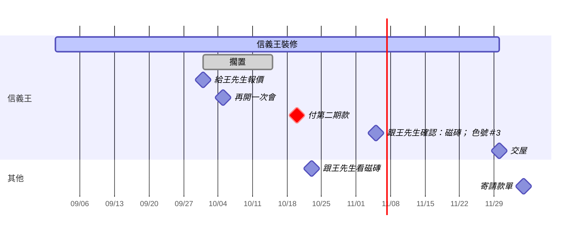

# 日程
這是什麼：要做的事與日期，程式從 .system/agenda.json 整理出來；〔推測〕是我從檔案讀到的，不對就跟我說。
怎麼用：跟我說「9/25 下午有個會」「交屋改 12/10」「第二期款付了」就會改這裡。
由程式產生，改了會被覆蓋。

## 逾期
- 2026-10-20（週二）到期 付第二期款（信義王）〔推測〕

## 今天
（沒有）

## 接下來 7 天
- 2026-10-23（週五）14:00 會議 跟王先生看磁磚

## 之後
- 2026-11-05（週四）承諾 跟王先生確認：磁磚; 色號#3（信義王）
- 2026-11-30（週一）到期 交屋（信義王）〔推測〕
- 2026-12-05（週六）提醒 寄請款單

## 時程圖

## 過去 30 天
- 2026-10-10 提醒 寄發票（信義王）已取消
- 2026-10-05 會議 再開一次會（信義王）已過去
- 2026-10-01 承諾 給王先生報價（信義王）完成
